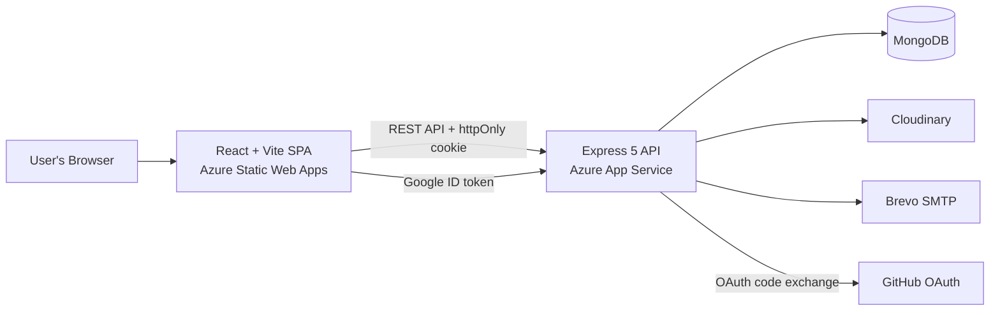

<div align="center">
 Ganeshaya Stays
 
**A full-stack hotel booking platform with secure multi-provider authentication, real-time availability checks, and a dedicated dashboard for hotel owners.**
 
[**Live Demo**](https://ganeshayastays.is-a-dev.site) · [Report a Bug](https://github.com/Beast18akash/ganeshaya-stays/issues) · [Architecture](#architecture)
 


 
</div>
---
 
## Overview
 
Ganeshaya Stays lets travelers discover hotel rooms, check availability for their dates, and book a stay. Hotel owners get their own area to register a property, publish rooms with photos and amenities, and track bookings and revenue.
 
I built it end to end: the React single-page app, the REST API, the database schema, third-party integrations (OAuth, image hosting, transactional email), and the CI/CD pipelines that deploy it to Azure.
 
## Features
 
### For guests
- **Search and discover:** search by destination, dates, and guest count from the home page.
- **Filter and sort:** filter by room type (Single Bed, Double Bed, Luxury Room, Family Suite) and price range, and sort by price or newest first.
- **Room details:** image gallery, amenities, and host information.
- **Availability check:** check whether a room is free for your dates before booking.
- **Booking and confirmation:** book a room and receive a confirmation email with the booking details.
- **My Bookings:** view all bookings with status (pending, confirmed, cancelled) and payment state.
- **Flexible sign-in:** email and password, Google, or GitHub, plus a full forgot and reset password flow.
### For hotel owners
- **Register a hotel:** one-step registration that upgrades the account to the owner role.
- **Dashboard:** total bookings, total revenue, and a table of recent bookings.
- **Add rooms:** upload up to 4 photos per room, set price per night, and pick amenities.
- **Manage inventory:** list all rooms and toggle availability with one click.
## Tech Stack
 
| Layer | Technologies |
|---|---|
| **Frontend** | React 19, Vite 8, Tailwind CSS 4, React Router 7, Axios, react-hot-toast, `@react-oauth/google` |
| **Backend** | Node.js, Express 5, Mongoose 9, JSON Web Tokens, bcryptjs, Multer, Nodemailer |
| **Database** | MongoDB |
| **Services** | Cloudinary (image storage and CDN), Brevo SMTP (email), Google Identity, GitHub OAuth |
| **DevOps** | GitHub Actions, Azure Static Web Apps (frontend), Azure App Service (backend) |
 
## Architecture
 

 
### Image upload and delivery
 
Room images never touch the database. The API receives the upload, stores it temporarily, pushes it to Cloudinary, and saves only the returned URL in MongoDB. The browser then loads images straight from the Cloudinary CDN.
 

 
## Engineering Highlights
 
**Authentication and security**
- Sessions use a signed JWT stored in an **httpOnly cookie** (7-day expiry), with `Secure` and `SameSite` set for production.
- **Google sign-in** verifies the ID token server-side against Google's public keys.
- **GitHub OAuth** uses the authorization-code flow with a random `state` value checked on callback to block CSRF, and the client secret never leaves the server.
- **Account linking:** one email always maps to one account. Signing in with a new provider links it to the existing user instead of creating a duplicate.
- **Password reset:** a random token is emailed to the user and only its **SHA-256 hash** is stored. Tokens expire after 15 minutes, and the forgot-password response is generic so it does not reveal which emails are registered.
- Passwords are hashed with bcrypt, and the auth middleware strips password and reset fields from the loaded user.
- CORS is restricted to an allowlist of origins with credentials enabled.
**Booking logic**
- Date validation on the server: no past dates, check-out after check-in, at least one guest.
- **Overlap detection:** a booking conflicts when `existing.checkIn < requested.checkOut` and `existing.checkOut > requested.checkIn`, ignoring cancelled bookings. A compound index on `room`, `checkInDate`, `checkOutDate`, and `status` keeps this lookup fast.
- Total price is calculated on the server from the number of nights, so the client cannot set its own price.
**Frontend performance and structure**
- Every route is **code-split** with `React.lazy` and `Suspense`.
- **Responsive, optimized images:** Cloudinary URLs are rewritten with `f_auto`, `q_auto`, and `dpr_auto`, with `srcset` and `sizes` so each device downloads an appropriately sized file.
- State is organized with **Context providers** (`AuthContext`, `AppContext`) that de-duplicate in-flight room requests and cache results.
- A `ProtectedRoute` guard redirects unauthenticated users to sign-in and returns them to the page they wanted.
- `useSyncExternalStore` powers a small media-query hook for responsive behavior.
**DevOps**
- Two independent GitHub Actions pipelines deploy the frontend and backend on every push to `main`.
- The backend pipeline authenticates to Azure with OIDC (`azure/login`) and only runs when files under `server/` change.
- Secrets and environment values are kept out of the repository through `.gitignore` and GitHub Actions secrets and variables.
## Project Structure
 
```
ganeshaya-stays/
├── .github/workflows/          # CI/CD for Azure Static Web Apps and Azure App Service
├── architecture of project/    # Image upload architecture diagram
├── client/                     # React + Vite single-page app
│   └── src/
│       ├── components/         # Navbar, Hero, HotelCard, HotelReg, Footer, ProtectedRoute, ...
│       ├── context/            # AuthContext, AppContext
│       ├── hooks/              # useDesktopMedia
│       ├── lib/                # Axios instance, Cloudinary image helpers
│       └── pages/              # Home, AllRooms, RoomDetails, MyBookings, SignIn, SignUp, ...
│           └── HotelOwner/     # Dashboard, AddRoom, ListRoom, Layout
├── server/                     # Express API
│   ├── config/                 # MongoDB, Cloudinary, Nodemailer setup
│   ├── controllers/            # auth, booking, hotel, room, user
│   ├── middleware/             # JWT auth guard, Multer upload
│   ├── models/                 # User, Hotel, Room, Booking
│   ├── providers/              # Google and GitHub OAuth handlers
│   ├── routes/                 # Route definitions
│   ├── services/               # Shared account-linking logic
│   └── utils/                  # JWT, cookie, and email helpers
└── package.json                # Root scripts (run client and server together)
```
 
## API Reference
 
All routes are prefixed with `/api`. Routes marked 🔒 require authentication.
 
| Method | Endpoint | Description |
|---|---|---|
| POST | `/auth/signup` | Create an account with email and password |
| POST | `/auth/signin` | Sign in and set the session cookie |
| POST | `/auth/logout` | Clear the session cookie |
| GET 🔒 | `/auth/me` | Get the current user |
| POST | `/auth/forgot-password` | Email a password reset link |
| POST | `/auth/reset-password/:token` | Set a new password |
| POST | `/auth/google` | Sign in with a Google ID token |
| GET | `/auth/github` | Start the GitHub OAuth flow |
| GET | `/auth/github/callback` | Complete the GitHub OAuth flow |
| GET 🔒 | `/user` | Get the user's role and recent searches |
| POST 🔒 | `/user/store-recent-search` | Save a recently searched city |
| POST 🔒 | `/hotels` | Register a hotel (upgrades the user to owner) |
| GET | `/rooms` | List all available rooms |
| POST 🔒 | `/rooms` | Create a room (multipart, up to 4 images) |
| GET 🔒 | `/rooms/owner` | List the owner's rooms |
| POST 🔒 | `/rooms/toggle-availability` | Enable or disable a room |
| POST | `/bookings/check-availability` | Check a room's availability for given dates |
| POST 🔒 | `/bookings/book` | Create a booking and send a confirmation email |
| GET 🔒 | `/bookings/user` | List the user's bookings |
| GET 🔒 | `/bookings/hotel` | Owner dashboard data (bookings and revenue) |
 
## Data Model
 
| Model | Key fields |
|---|---|
| **User** | `fullname`, `email` (unique), `password` (hashed), `providers[]` (local, google, github), `role` (user or hotelOwner), `profilePicture`, reset token fields |
| **Hotel** | `name`, `address`, `contact`, `city`, `owner` → User |
| **Room** | `hotel` → Hotel, `roomType`, `pricePerNight`, `amenities[]`, `images[]`, `isAvailable` |
| **Booking** | `user`, `room`, `hotel`, `checkInDate`, `checkOutDate`, `guests`, `totalPrice`, `status`, `paymentMethod`, `isPaid` |
 
## Getting Started
 
### Prerequisites
- Node.js 20 or later
- A MongoDB database (local or Atlas)
- A Cloudinary account
- An SMTP provider (the project is configured for Brevo)
- Optional: Google and GitHub OAuth apps for social sign-in
### Installation
 
```bash
git clone https://github.com/Beast18akash/ganeshaya-stays.git
cd ganeshaya-stays
 
npm install                  # root tooling (runs client and server together)
npm install --prefix client
npm install --prefix server
```
 
### Environment variables
 
Create `server/.env`:
 
```env
PORT=5000
NODE_ENV=development
CLIENT_URL=http://localhost:5173
MONGODB_URI=your_mongodb_connection_string
JWT_SECRET=a_long_random_string
 
CLOUDINARY_CLOUD_NAME=your_cloud_name
CLOUDINARY_API_KEY=your_api_key
CLOUDINARY_API_SECRET=your_api_secret
 
SMTP_USER=your_smtp_login
SMTP_PASS=your_smtp_password
SENDER_EMAIL=bookings@yourdomain.com   # optional, falls back to SMTP_USER
 
GOOGLE_CLIENT_ID=your_google_client_id
GITHUB_CLIENT_ID=your_github_client_id
GITHUB_CLIENT_SECRET=your_github_client_secret
GITHUB_CALLBACK_URL=http://localhost:5000/api/auth/github/callback
```
 
Create `client/.env`:
 
```env
VITE_BACKEND_URL=http://localhost:5000
VITE_GOOGLE_CLIENT_ID=your_google_client_id
```
 
### Run locally
 
```bash
npm run dev
```
 
The app runs at `http://localhost:5173` and the API at `http://localhost:5000`.
 
### Scripts
 
| Command | What it does |
|---|---|
| `npm run dev` | Start the client and the server together |
| `npm run client` | Start only the Vite dev server |
| `npm run server` | Start only the API with nodemon |
| `npm run build` | Install dependencies and build the client |
| `npm start` | Start the API, which also serves the built client from `client/dist` |
 
## Deployment
 
Both halves deploy automatically from `main` through GitHub Actions:
 
- **Frontend:** `azure-static-web-apps-*.yml` builds the Vite app and deploys it to Azure Static Web Apps, with preview environments for pull requests.
- **Backend:** `main_ganeshaya-api-akash-2026.yml` installs production dependencies and deploys the API to Azure App Service using OIDC login. It runs only when `server/` changes, or manually through `workflow_dispatch`.
The repository also includes a SPA rewrite config for Vercel (`client/vercel.json`), and the API can serve the built client itself for single-host deployments.
 
## Roadmap
 
- [ ] Online payments (the booking model already tracks `isPaid` and `paymentMethod`)
- [ ] Guest-initiated booking cancellation and owner-side booking management
- [ ] Reviews and ratings backed by real booking data
- [ ] Automated tests for the booking and auth flows
- [ ] Build out the Experience page
## Author
 
**Akash Holsambre**
 
[GitHub](https://github.com/Beast18akash) · [Email](mailto:holsambreakash18@gmail.com)
 
If you're a recruiter or hiring manager and have questions about any design decision in this project, I'm happy to walk you through it.
 
